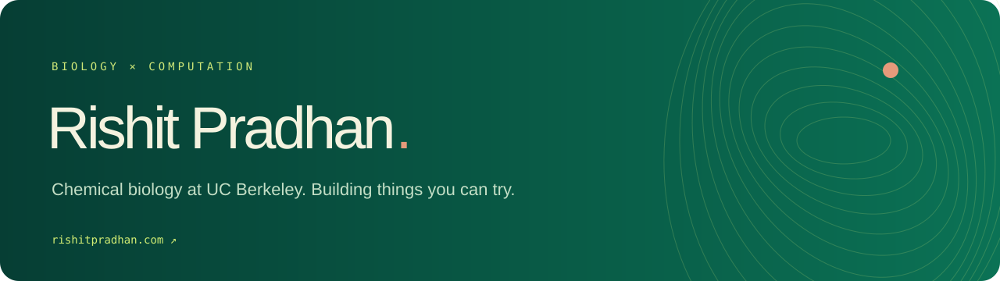

Chemical biology at UC Berkeley. I’m building **DreamIT**, focused on 3D world engines for multiplayer games, and **Drip**, focused on live wearable-data insights. I also make small interactive systems to explore ideas in biology and computation.

[Portfolio](https://rishitpradhan.com) · [LinkedIn](https://www.linkedin.com/in/rishit-pradhan-a49773352) · [Drip prototype](https://drip-demo-dashboard.vercel.app/)

## Start here

- **[Sift](https://github.com/rishitpradhan-gif/sift)** — browser-local CSV audits, schema drift detection, and a downloadable streaming API. Tested on a million-row input. [Download API ↗](https://github.com/rishitpradhan-gif/sift/releases/latest)
- **[Trellis](https://github.com/rishitpradhan-gif/trellis)** — dependency planning with critical paths, cycle witnesses, delay simulation, and a downloadable API. Tested with 50,000 tasks and 199,990 edges. [Download API ↗](https://github.com/rishitpradhan-gif/trellis/releases/latest)
- **[Prerequisite Pairings](https://github.com/rishitpradhan-gif/prerequisite-pairings)** — an exact characterization of legal paired replies under arbitrary prerequisite orders, plus quotient state and play-counting theorems; checked against 72,482 exhaustive instances.
- **[Fourteen](https://github.com/rishitpradhan-gif/fourteen)** — a sharp 14-ply obstruction to fixed pairing strategies on odd Connect Four boards, proved constructively and checked with independent grid search.
- **[Connect Four Research](https://github.com/rishitpradhan-gif/connect4-proof-lab)** — proof-oriented game-theory research: structural pairing theorems, independently checked certificates, and C++20 adversarial search. [Research note ↗](https://github.com/rishitpradhan-gif/connect4-proof-lab/releases/download/v0.1.0/connect4-proof-lab-research-note.pdf)
- **[Portfolio](https://github.com/rishitpradhan-gif/portfolio)** — the deployed site: a living DNA environment, research, project demos, and playable tennis. [Visit ↗](https://rishitpradhan.com)
- **[Morphogenesis](https://github.com/rishitpradhan-gif/morphogenesis-lab)** — paintable Gray–Scott reaction–diffusion patterns, editable chemistry, and PNG export. [Try ↗](https://rishitpradhan.com/projects/morphogenesis/)
- **[Rally Court](https://github.com/rishitpradhan-gif/rally-court)** — a tennis-inspired canvas game with collision physics, an opponent, three lives, and local best scores. [Play ↗](https://rishitpradhan.com/#offscreen)
- **[World Garden](https://github.com/rishitpradhan-gif/world-garden)** — an isometric SVG sandbox with pointer-to-world mapping and tree-building controls. A local concept experiment.
- **[Wearable Signals](https://github.com/rishitpradhan-gif/wearable-signal-lab)** — a simulated signal interface with an activity-controlled readout, waveform, and reduced-motion support.

These public experiments include runnable source and implementation notes. World Garden and Wearable Signal Lab illustrate product directions; they are separate from the DreamIT and Drip production code.

## Currently interested in

Molecules, useful interfaces, shared virtual worlds, and making complicated systems easier to explore. Away from the desk: tennis.
