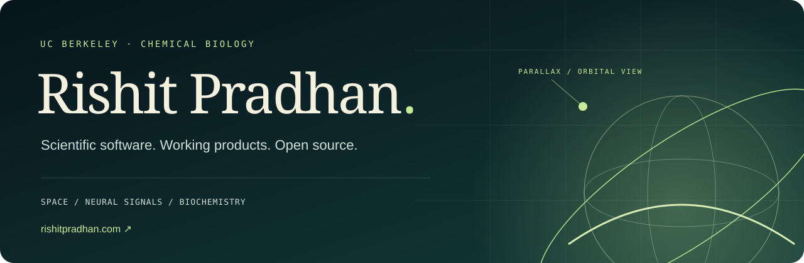
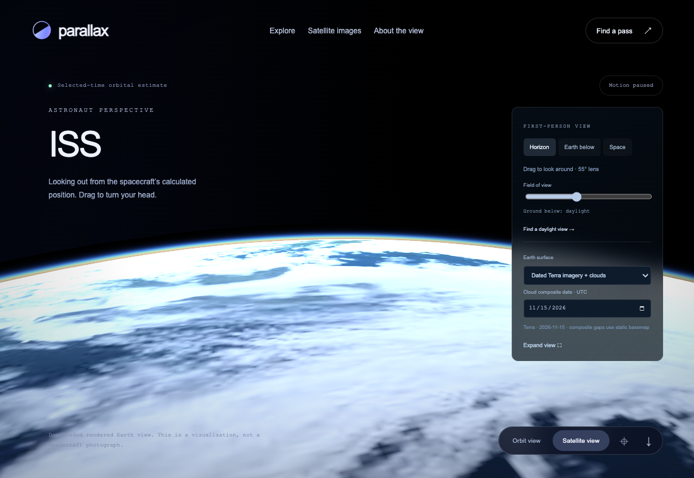
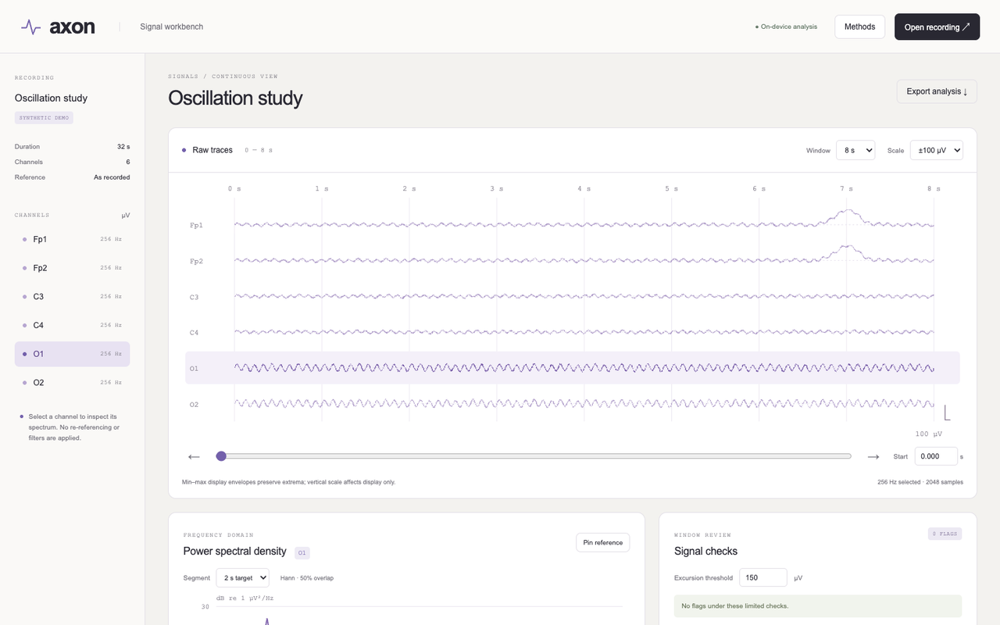
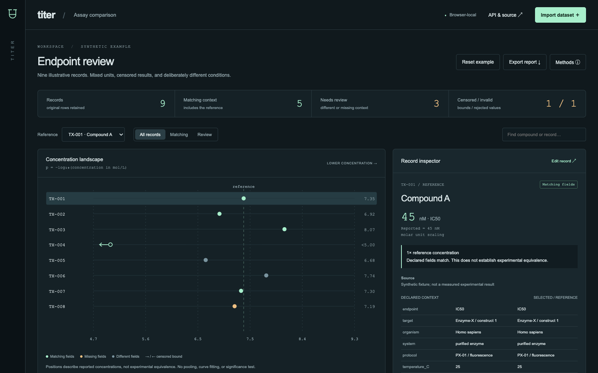

<a href="https://rishitpradhan.com"><b>Portfolio</b></a> &nbsp; / &nbsp; <a href="https://rp-parallax.vercel.app"><b>Explore Parallax</b></a> &nbsp; / &nbsp; <a href="TOOLS.md">Downloads & APIs</a> &nbsp; / &nbsp; <a href="https://www.linkedin.com/in/rishit-pradhan-a49773352">LinkedIn</a>

I’m Rishit, a chemical biology student at UC Berkeley. I build software for exploring physical systems and working with scientific data. These are the projects I’d start with.

## 01 — Parallax

**Earth from the spacecraft’s point of view.**

Real CelesTrak orbital elements, SGP4 propagation, a first-person WebGL camera, and dated NASA imagery. Choose a spacecraft, look across its horizon, and calculate passes over a location.

**[Open the app ↗](https://rp-parallax.vercel.app)** · [Case study](https://rishitpradhan.com/projects/parallax/) · [Source & methods](https://github.com/rishitpradhan-gif/parallax) · [iPhone project](https://rp-parallax.vercel.app/ios.html)

Checked against published SGP4 vectors and horizon geometry. Earth views are rendered; NASA images are dated. The iPhone source is prepared, with native compilation and device testing still pending.

## 02 / 03 — Scientific workbenches

<table>
<tr>
<td width="50%" valign="top">

<h3>Axon</h3>

Inspect EEG recordings locally. Calibrated EDF/CSV import, traces, Welch spectra, quality flags, and reproducible analysis exports.

<b>Numerical checks:</b> independent DFT tests and an executed twelve-signal SciPy comparison.

<a href="https://rp-axon.vercel.app"><b>Open workbench ↗</b></a> · <a href="https://github.com/rishitpradhan-gif/axon">Source</a> · <a href="https://rishitpradhan.com/projects/axon/">Case study</a>

</td>
<td width="50%" valign="top">

<h3>Titer</h3>

Compare assay endpoints without losing units or experimental context. Preserve censored bounds and inspect reference-relative concentration ratios.

<b>Downloadable API:</b> a local Node service with expiring, revocable API keys and an OpenAPI specification.

<a href="https://rp-titer.vercel.app"><b>Open workbench ↗</b></a> · <a href="https://github.com/rishitpradhan-gif/titer">Source</a> · <a href="https://rishitpradhan.com/projects/titer/">Case study</a>

</td>
</tr>
</table>

Axon’s example is synthetic and its analysis is descriptive, not clinical. Titer checks declared context; a concentration ratio does not establish experimental or biological equivalence.

## 04 / 05 / 06 — Systems you can run

**[Sift](https://github.com/rishitpradhan-gif/sift)** &nbsp; `DATA QUALITY` 
CSV profiling, schema-drift checks, and a downloadable streaming API. [Try it ↗](https://rp-sift.vercel.app)

**[Trellis](https://github.com/rishitpradhan-gif/trellis)** &nbsp; `DEPENDENCY GRAPHS` 
Critical paths, explicit cycle witnesses, and delay-impact analysis. [Try it ↗](https://rp-trellis.vercel.app)

**[Canopy](https://github.com/rishitpradhan-gif/canopy)** &nbsp; `WEARABLE-NETWORK RESEARCH` 
Challenge a shared-event finding by removing witnesses and varying analysis choices. Seeded adversarial evaluations retain missed events and confounder failures. Simulation research; no physical-device or clinical validation. [Research branch](https://github.com/rishitpradhan-gif/canopy/tree/codex/independent-stress-generator)

---

### Also worth a look

[Connect Four structural proofs](https://github.com/rishitpradhan-gif/fourteen) · [Prerequisite-order theorems](https://github.com/rishitpradhan-gif/prerequisite-pairings) · [Paintable reaction–diffusion](https://rishitpradhan.com/projects/morphogenesis/) · [Student apps & extensions](TOOLS.md#student-tools--apps-and-browser-extensions)

<b>More projects, downloads & development context</b>

The [full tool guide](TOOLS.md) includes local apps, browser extensions, APIs, and research verifiers. [Browse the public project directory](https://rp-projects.vercel.app).

I’m also developing DreamIT, focused on multiplayer world engines, and Drip, focused on wearable-data interfaces. Public concept previews are separate from production product code. The [portfolio](https://rishitpradhan.com) includes my research background and project notes.

